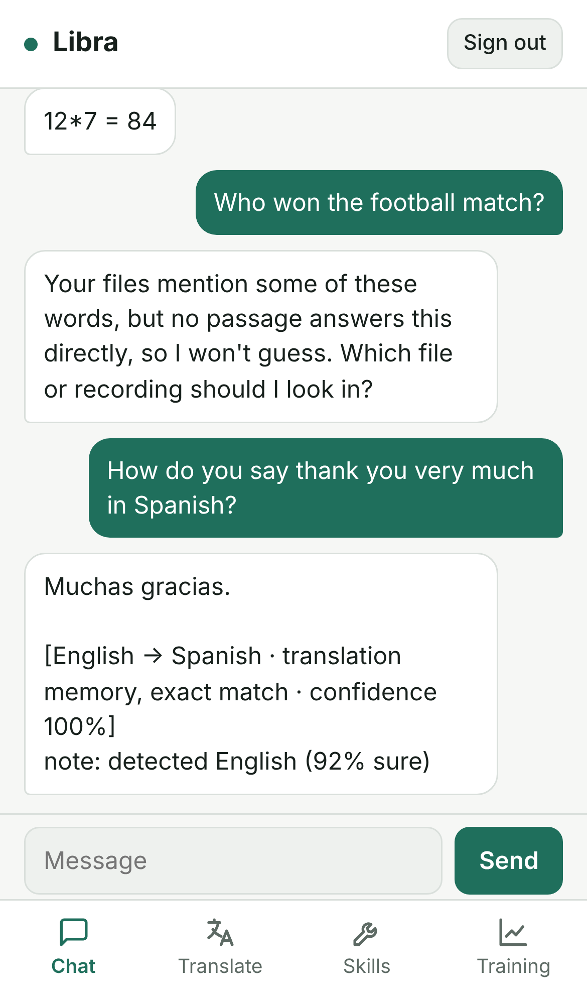
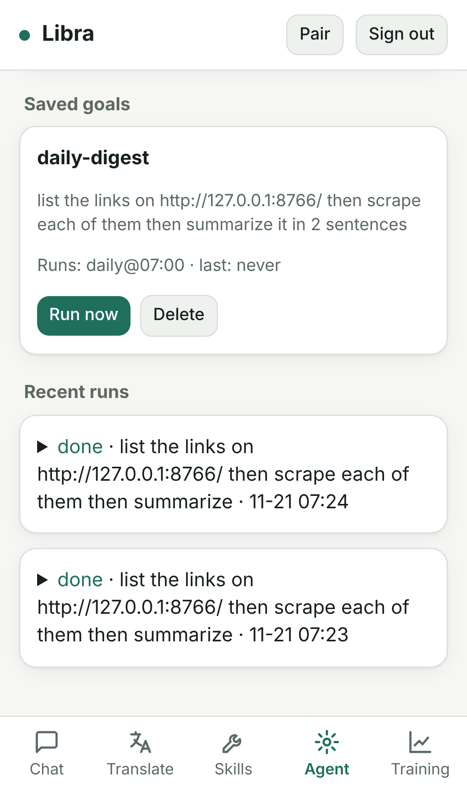

# Libra: a language model written from scratch

Libra is a small GPT-style language model where **every piece is original code**. It uses no pretrained weights, no downloaded model, no API key and no subscription. You train it on your own text, and it runs on your own computer.

[](https://github.com/Sweitz1/Libraries-/actions/workflows/test.yml)
[](https://github.com/Sweitz1/Libraries-/actions/workflows/android.yml)
[](https://github.com/Sweitz1/Libraries-/releases)
[](LICENSE)


The only dependency is **NumPy**. Everything else is in this repo.

<table>
<tr>
<td width="33%" valign="top"><h3>🧠 The model</h3><p>A GPT-style transformer, autograd engine, tokenizer and optimizer, all written here. CPU or NVIDIA GPU.</p><p><a href="#training-on-your-own-text"><b>Train it →</b></a></p></td>
<td width="33%" valign="top"><h3>📱 Phone and web app</h3><p>Chat, translate, run skills and goals from your phone. Native Android app with notifications; iPhone through Safari.</p><p><a href="docs/MOBILE.md"><b>Get the app →</b></a></p></td>
<td width="33%" valign="top"><h3>🖥️ Debian server</h3><p>One command installs the service, nightly training, scheduled goals, Tailscale HTTPS and QR pairing.</p><p><a href="deploy/README.md"><b>Deploy it →</b></a></p></td>
</tr>
<tr>
<td width="33%" valign="top"><h3>🎯 Goal agent and jobs</h3><p>Plain-language goals planned into skill steps. Jobs survive restarts, wait for your approval and check their results.</p><p><a href="#goal-agent-plain-language-goals-run-with-your-skills"><b>Give it a goal →</b></a></p></td>
<td width="33%" valign="top"><h3>🌙 Unattended training</h3><p>Collects text from sites you choose, filters it, trains, and keeps the new model only if it isn't worse.</p><p><a href="#automatic-training-from-the-web"><b>Set it up →</b></a></p></td>
<td width="33%" valign="top"><h3>📂 Your files, with citations</h3><p>Answers grounded in your documents, quoted with line numbers. Says so when the answer isn't there.</p><p><a href="#your-files-as-a-knowledge-base-grounded-answers"><b>Add your files →</b></a></p></td>
</tr>
<tr>
<td width="33%" valign="top"><h3>🧩 Skills, MCP and APIs</h3><p>Built-in tools, your own plugins, MCP servers and OpenAPI imports, searchable up to a million skills.</p><p><a href="#skill-catalog-mcp-servers-web-apis-and-trust-controls"><b>Add skills →</b></a></p></td>
<td width="33%" valign="top"><h3>🌍 Translation</h3><p>Translation memory, word alignment, language detection for 28 languages, romanization.</p><p><a href="#translation-and-language-tools"><b>Translate →</b></a></p></td>
<td width="33%" valign="top"><h3>🕸️ Web scraper and crawler</h3><p>robots.txt, rate limits, CSS selectors, and a guard against reaching private addresses.</p><p><a href="#web-scraper-and-crawler"><b>Scrape a page →</b></a></p></td>
</tr>
<tr>
<td width="33%" valign="top"><h3>🔐 Trust and security</h3><p>Ask or deny rules by risk, per-device tokens, audit log. Web content can't trigger changes on its own.</p><p><a href="SECURITY.md"><b>Read the model →</b></a></p></td>
<td width="33%" valign="top"><h3>📊 Benchmarks</h3><p>Measure the planner and the model before changing them; training can require behaviour not to drop.</p><p><a href="#benchmarks-measure-before-changing-things"><b>Run them →</b></a></p></td>
<td width="33%" valign="top"><h3>💬 Discord and memory</h3><p>A Discord bot for your server, and long-term memory of facts and goal results.</p><p><a href="#discord"><b>Connect Discord →</b></a></p></td>
</tr>
</table>

**More:** [Java client](clients/java/README.md) · [Templates](templates) to copy · [Changelog](CHANGELOG.md) · [Contributing](CONTRIBUTING.md) · [Security](SECURITY.md) · [Releases](https://github.com/Sweitz1/Libraries-/releases)

For a reviewer's map of every app, server, service and capability, with links to the code, see **[docs/REVIEW.md](docs/REVIEW.md)**.

| File | What it is |
|---|---|
| `libra/backend.py` | CPU (NumPy) or NVIDIA GPU (CuPy) array backend |
| `libra/autograd.py` | Reverse-mode automatic differentiation engine (tensors, broadcasting, matmul, softmax, layer norm, GELU, cross-entropy, embeddings, dropout) |
| `libra/nn.py` | Modules and the transformer: causal multi-head self-attention, MLP, pre-norm residual blocks, tied embeddings |
| `libra/tokenizer.py` | Byte-level BPE tokenizer trained on your corpus, with chat special tokens |
| `libra/optim.py` | AdamW, gradient clipping, warmup + cosine learning-rate schedule |
| `libra/train.py` | Data loading (`.txt`, `.md`, `.jsonl` chats), training loop, validation, checkpoints, resume |
| `libra/generate.py` | Fast sampling with a key/value cache: temperature, top-k, top-p, repetition penalty, streaming UTF-8 decode |
| `libra/dataset.py` | Dataset builder: files, chat exports, web pages and Project Gutenberg books into clean, de-duplicated training data |
| `libra/server.py` | OpenAI-compatible HTTP API (standard library only), with streaming |
| `libra/web.py` | Web fetcher (robots.txt, rate limits, private-address guard), HTML parser, CSS selector engine, scraper and crawler |
| `libra/skills.py` | Skills (tools), plugin loader, message routing, built-in skills |
| `libra/catalog.py` | Skill catalog: SQLite with an inverted BM25 index, lazy loading, schema-based argument checking |
| `libra/mcp.py` | MCP client (stdio and Streamable HTTP) that syncs server tools into the catalog |
| `libra/openapi.py`, `libra/yamlish.py` | OpenAPI/Swagger importer and caller; a small YAML reader for specs |
| `libra/trust.py` | Risk levels, allow/ask/deny rules, confirmation prompts, audit log |
| `libra/translate.py`, `libra/lang.py` | Translation memory, IBM Model 1 alignment, adaptation, glossing, pivoting; language detection and romanization |
| `libra/webui/` | The phone/browser app served at `/` (no external files; works offline on your network) |
| `libra/autonomy.py`, `libra/memory.py` | Autonomous plan → act → check → adjust loop with learned procedures; long-term memory |
| `libra/discord.py`, `libra/websocket.py`, `libra/notify.py` | Discord bot (gateway + REST), a from-scratch WebSocket client, notifications (ntfy, Discord webhooks, any URL) |
| `libra/jobs.py`, `libra/evaluate.py` | Durable jobs (resumable goals with approvals and checked results); benchmarks for the planner and the model |
| `android/` | The Android app: pairing, Keystore sign-in, notifications ([docs/MOBILE.md](docs/MOBILE.md)) |
| `clients/java/` | A dependency-free Java client (pairing, chat, translate, skills, jobs), published to GitHub Packages ([README](clients/java/README.md)) |
| `templates/`, `scripts/` | Templates to copy (plugin, benchmark suites, training config); the release script |
| `libra/agent.py` | Goal agent: plans plain-language goals into skill steps, runs them under trust rules and limits, schedules |
| `libra/qr.py`, `libra/pair.py` | QR codes (from scratch) and phone pairing: best address + token as a scannable link |
| `deploy/` | Debian installer (systemd services and timers, Tailscale, .local name, token, QR pairing), Caddy HTTPS example, setup guide |
| `libra/auto.py` | Unattended collect → filter → train → gate → report runs, with locking, limits, rollback and scheduling |
| `libra/knowledge.py` | Workspace of your files: BM25 search, cited grounded answers, clarifying questions, corrections and rules |
| `libra/cli.py` | `libra data / train / auto / agent / memory / discord / pair / devices / generate / chat / serve / kb / translate / skill / mcp / api / trust / scrape / crawl / info` |

Each operation in the autograd engine, and the full model, is checked against numerical gradients in `tests/`.

## Run it on a Debian server and use it from your phone

```bash
sudo ./deploy/install-debian.sh
```

This installs Libra as a service. It starts at boot, runs nightly training and scheduled agent goals, requires a token, and shows up on your Wi-Fi as `http://<machine>.local:8000`. At the end it prints a **QR code: scan it with your phone's camera** and the app opens already signed in.

- **Away from home:** add `--tailscale` (or `--tailscale-only`). The installer sets up Tailscale and serves Libra at `https://libra.<your-tailnet>.ts.net`.
- **The app** has Chat (your files or the model), Translate, Skills, Agent and Training tabs, plus a *Pair* button that shows a QR code for adding your other devices. It installs to the home screen with its own icon.

- **Android app:** a native app with the same screens, the sign-in in the Android Keystore, and notifications when a goal needs your approval or finishes, or when training decides on a model. Pair it with `libra pair --app`. iPhone: use the web app (Safari → *Add to Home Screen*) for now; the app's contract with the server is documented for an iOS version. See **[docs/MOBILE.md](docs/MOBILE.md)**.

**[deploy/README.md](deploy/README.md)** covers the rest.

<p> </p>

## Install

```bash
git clone https://github.com/Sweitz1/Libraries-.git
cd Libraries-
pip install -e .          # or just: pip install numpy, then use "python -m libra"
```

Python 3.9+. Each [release](https://github.com/Sweitz1/Libraries-/releases) also has a ready-made wheel (`pip install libra_lm-*.whl`), the Android app (`libra.apk`) and `SHA256SUMS` to check them against.

## Minimum resources

Everything except training runs in about **50 MB of RAM**. Training is the only demanding part. Measured on a 4-core CPU without a GPU:

| What you're doing | Peak RAM | Disk | Speed |
|---|---|---|---|
| Grounded answers, translation, skills, serving a trained model | 35–80 MB | grows with your data | 0.1–0.2 s per answer |
| Train tiny (0.3M parameters) | 185 MB | 4 MB model | 7,000 tokens/s |
| Train small (0.9M, the default) | 882 MB, or 257 MB with `--batch 4` | 14 MB model | 2,500 tokens/s |
| Train medium (5M) | 6.6 GB, 1.7 GB with `--batch 4`, 0.95 GB with `--batch 2` | 76 MB model | 500–700 tokens/s |
| Skill catalog with 1,000,000 skills | small | 567 MB | 140–260 ms per search |

That means roughly 4–5 hours for 20,000 steps of the small model, and about 1.5 days for the medium one, on those 4 cores. An NVIDIA GPU (`--device gpu`) should be much faster, but that hasn't been measured. No internet is needed except for crawling, web APIs, remote MCP servers and downloading data.

## Quick start

```bash
# 1. Train on the bundled sample data (about 30 seconds on a laptop)
libra train data --out checkpoints/demo --steps 300 --vocab 512 --ctx 64 --layers 2 --embd 96

# 2. Chat with it
libra chat --model checkpoints/demo

# 3. Or continue a prompt
libra generate --model checkpoints/demo --prompt "The library"
```

The sample data is tiny, so the demo model mostly repeats what it saw. To get a model that writes new text, train it on more data.

## Build a dataset

`libra data` gathers text from many places, cleans it, removes duplicates and tells you what model size and step count fit:

```bash
libra data my_notes/ chats.jsonl faq.csv \
  --gutenberg 1342 --gutenberg 84 \
  --url https://example.com/article.html \
  --out datasets/mine
libra train datasets/mine ...   # use the command it suggests
```

It understands:

| Input | How it's used |
|---|---|
| `.txt` `.md` `.rst` | Plain text (Project Gutenberg headers and licences are stripped automatically) |
| `.html` `.htm` | Page text only, without scripts, menus and footers |
| `.jsonl` / `.json` with `messages` | Chats (OpenAI format) |
| ChatGPT export `conversations.json` | Chats, following each conversation's thread |
| ShareGPT (`conversations` with `from`/`value`) | Chats |
| Alpaca (`instruction`, `input`, `output`) | Chats |
| `.csv` / `.tsv` with question/answer (or prompt/response) columns | Chats; any other CSV becomes text |
| `--gutenberg N` | Downloads public-domain book number N from gutenberg.org |
| `--url URL` | Downloads a web page or text file |

The output folder holds `text.jsonl`, `chat.jsonl` and `stats.json`, with character counts, an estimated token count and the suggested `libra train` command. Only use text you have the right to use.

## Training on your own text

Point `libra train` at files or folders:

- **`.txt` / `.md`**: plain text. Books, notes, articles, code.
- **`.jsonl`**: one JSON object per line, either
  - `{"messages": [{"role": "user", "content": "..."}, {"role": "assistant", "content": "..."}]}` to teach it to chat, or
  - `{"text": "..."}` for plain documents.

```bash
libra train my_books/ my_chats.jsonl --out checkpoints/mine --steps 5000
libra train my_books/ --out checkpoints/mine --steps 10000 --resume   # keep going later
```

`checkpoints/mine/` holds the latest checkpoint and `checkpoints/mine/best/` holds the one with the lowest validation loss.

### Size guide (CPU)

| Preset | Flags | Parameters | Good for |
|---|---|---|---|
| Tiny | `--layers 2 --embd 96 --ctx 64` | ~0.3M | Testing, under 100 KB of text |
| Small (default) | `--layers 4 --embd 128 --ctx 128` | ~1M | 1–10 MB of text |
| Medium | `--layers 6 --embd 256 --heads 8 --ctx 256 --vocab 4096` | ~6M | 10 MB+ of text, overnight runs |
| Large (GPU) | `--layers 8 --embd 384 --heads 6 --ctx 256 --vocab 8192 --device gpu` | ~17M | 50 MB+ of text |

A rule of thumb: you want at least about 20 training tokens per parameter. Keep an eye on the logged `val loss`. If it rises while the training loss keeps falling, the model is memorising: add text or use a smaller model.

**What to expect:** a model this size learns the style, vocabulary and common phrases of its data. It does not know facts about the world that you don't teach it. Quality grows with the amount of text and training time.

### Useful flags

`--vocab` tokenizer size · `--ctx` context length · `--layers` `--heads` `--embd` model size · `--batch` batch size · `--steps` training steps · `--lr` peak learning rate · `--dropout` · `--eval-every` · `--resume` · `--sample-prompt` text used for the preview printed at each evaluation.

## Automatic training from the web

`libra auto` runs the whole loop unattended: **collect, filter, train, and keep the new model only if it's better**. Then it writes a short report you can check in a minute.

```bash
libra auto init libra-auto.json            # writes a config to edit
libra auto run libra-auto.json --dry-run   # see what would be collected and dropped; writes nothing
libra auto run libra-auto.json             # one real run
libra auto schedule libra-auto.json --at 02:30 --install   # every night (Linux/macOS crontab)
libra auto status libra-auto.json          # last report, and how many runs improved the model
libra auto rollback libra-auto.json        # go back to the model before the last change
```

No scheduler available? `libra auto run libra-auto.json --loop --every 24` keeps running in the foreground. On Windows, `libra auto schedule` prints the `schtasks` command to use.

### The config

```json
{
  "name": "my-model",
  "sources": [
    {"crawl": "https://example.com/docs/", "max_pages": 100, "depth": 2, "include": "", "exclude": ""},
    {"feed": "https://example.com/blog/feed.xml", "max_items": 20},
    {"sitemap": "https://example.com/sitemap.xml", "max_pages": 50},
    {"url": "https://example.com/about"},
    {"gutenberg": 1342},
    {"files": "~/my-notes"}
  ],
  "dataset": "datasets/auto",
  "model": "checkpoints/auto",
  "model_config": {"layers": 4, "embd": 128, "heads": 4, "ctx": 128, "vocab": 1024, "batch": 16},
  "steps_per_run": 2000,
  "filters": {"min_chars": 300, "language": "en", "max_symbol_ratio": 0.25, "mask_personal_info": true},
  "limits": {"max_pages_per_run": 300, "max_dataset_mb": 500, "max_minutes": 120, "min_free_disk_mb": 2000,
             "delay_seconds": 1.0, "retries": 2, "retry_delay_seconds": 5},
  "gate": {"holdout_fraction": 0.05, "max_regression": 0.02, "eval_suite": "", "max_eval_drop": 0.0},
  "discover": true,
  "notify": {"url": "", "on": "changes"}
}
```

Relative paths are relative to the config file. YAML configs (`.yaml`) work too.

### What one run does

1. **Locks**, so overlapping runs can't happen (a lock left by a crashed run is ignored), and checks free disk space and the dataset size limit.
2. **Collects** from your sources:
   - Crawls obey robots.txt and wait between requests.
   - A page budget caps each run.
   - Pages that haven't changed since last time are skipped.
   - Feeds (RSS and Atom) bring in new posts as they appear, and sitemaps (including sitemap indexes) list a site's pages, newest first.
   - **New sources are found automatically** (`"discover": true`). For every crawled site, Libra reads the sitemaps listed in its robots.txt (or `/sitemap.xml`) and the RSS/Atom feeds its pages link to, re-checking weekly. The report lists what it found.
   - **Temporary errors are retried** (timeouts, connection drops, HTTP 429 and 5xx) with growing pauses. A 404 or a robots.txt block is not retried.
   - A page that appears in both a crawl and a sitemap is fetched only once.
3. **Filters** each document:
   - It removes boilerplate lines (cookie banners, "share on", "sign in", copyright footers) and stray fragments.
   - It drops documents that are too short, mostly symbols or numbers, in the wrong language, repetitive, or duplicates.
   - It **masks e-mail addresses and phone numbers**.
   - The report counts every drop by reason.
4. **Trains a copy** of the current model, or a new one on the first run, for `steps_per_run` steps within `max_minutes`. Your current model is never touched while this happens.
5. **Gates the result.** One in 20 kept documents (`holdout_fraction`) goes to a held-out set that is never trained on. The old and new models are both scored on it, and the new one replaces the old only if it's no worse than `max_regression` allows (2% by default). Otherwise it's set aside in `checkpoints/auto.rejected`. The replaced model stays in `checkpoints/auto.previous` for `rollback`. Lower loss doesn't by itself mean better answers, so you can also set `"eval_suite": "builtin"` (or a path to your own suite, see *Benchmarks*). The new model must then also not score lower on behaviour than the old one, beyond `max_eval_drop`.
6. **Reports** to `datasets/auto/.auto/last-report.md` (and appends to `runs.jsonl`). While it runs, it writes live progress (phase, pages, training step and loss), which the app's Training tab shows as a progress bar.

```
- pages fetched: 10 (unchanged since last time: 0)
- documents kept: 5 (4,213 characters); masked e-mails/phones: 2
- dropped: mostly symbols or numbers: 1, too short: 3, wrong language (fr): 1
- training: 40 steps; held-out loss: old 4.1497 → new 3.9297
- decision: kept the new model (held-out loss did not get worse)
```

### Notifications on your phone

Set `"notify": {"url": "https://ntfy.sh/<a-long-random-topic>", "on": "changes"}` and install the free [ntfy](https://ntfy.sh) app subscribed to that topic. Libra then sends each run's report as a push notification. Any webhook URL that accepts a POST works too, including your own ntfy server. Choose `"on"`:
- `"always"`: every run.
- `"changes"`: when a new model is kept, or something failed.
- `"failures"`: only when something failed.

The app can also notify you itself when a run finishes while it's open in the background (over HTTPS, e.g. through Tailscale).

On the Debian service, a failed run (network down, disk full) is retried up to 3 times, 20 minutes apart.

### What still needs you

- **Pick the sources.** Choose sites you trust and whose terms allow training on their text: your own sites, documentation you have rights to, public-domain books. Crawling the open web at random mostly teaches junk.
- **Glance at the report** now and then. The gate catches a model getting worse; it can't tell you whether the text was what you wanted.
- **Expect gradual progress.** On a 4-core computer the default model trains at about 2,500 tokens/s, so each nightly run moves it a little. See *Minimum resources* for sizes and speeds.

## Benchmarks: measure before changing things

```bash
libra eval plan                                   # does the planner pick the right skills? (28 labelled goals)
libra eval model checkpoints/web                  # the model's behaviour on 40 multiple-choice items
libra eval model checkpoints/web --text held.txt  # plus held-out loss and perplexity on text it never saw
libra eval history                                # every result, so a regression shows up
```

Each run is recorded in `~/.libra/eval/history.jsonl` with the checkpoint version, and printed with the change since the last comparable run. The model is measured in three separate ways, because they don't move together:
- **Held-out loss and perplexity**, on text it didn't train on.
- **Behaviour, by likelihood.** For each item, which continuation the model finds most probable ("The cats" → " are sleeping." or " is sleeping."), scored per token so length doesn't decide. This works even for small models. The built-in suite covers agreement, tense, common phrases, simple facts, common sense and sequences, reported per tag and next to the chance level.
- **Generation checks.** In your own suite, `{"prompt": "…", "expect": ["…"]}` requires the greedy reply to contain one of the expected strings.

Suites are JSON Lines. See [`libra/evals/`](libra/evals) for the built-in ones and [`evaluate.py`](libra/evaluate.py) for the format. Two baselines to compare against: the planner scores 27/28 on its suite (it refuses "calculate 17% of 250"). A 130K-parameter model trained only on this README scores 0.425 on behaviour, against 0.39 for random guessing. A small model needs far more, and broader, text to do much better.

## Goal agent: plain-language goals, run with your skills

```bash
libra agent plan "scrape https://example.com/news then summarize it in 3 sentences then translate it to Spanish"
libra agent run  "list the links on https://example.com/blog then scrape each of them then summarize it"
libra agent add morning "scrape https://example.com/news then summarize it" --every daily@07:00
libra agent list            # saved goals, their schedules and last results
libra agent runs            # recent runs
```

The app's **Agent** tab does the same: preview a plan, run it, save and schedule goals, and read past runs.

**How it plans.** Libra's own model is too small to plan reliably, so the agent plans with rules and search:
1. The goal is split at "then", "and then", ";", new lines, or "and" before an action word.
2. Each part is matched to a skill:
   - phrases with a fixed meaning: *summarize*, *translate … to <language>*, *detect the language*
   - the skills' own triggers: scrape, crawl or list links with a URL, calculations, the time
   - otherwise a search across every skill (built-ins, plugins, the MCP/API catalog), accepted only if the skill's name and description cover at least half of the part's key words
3. Words like *it*, *them* or *the result* pass the previous step's output along.
4. *each of them*, or several URLs in one step, runs that step once per item (up to `--max-items`, default 5).
5. If a part matches nothing clearly, the plan is refused with the reason. It never guesses. Always check `libra agent plan` first.

**How it runs.** Every step goes through the trust controls, like any other skill:
- Read-only skills run.
- Skills that change something ask first in the terminal. Scheduled goals and goals started from the app run as **durable jobs** (below): a step that needs approval pauses the job until you approve it, from the app or with `libra jobs approve`.
- Runs stop at `--max-steps` (10) and `--max-minutes` (5).

**Per-goal permissions.** A saved goal may only ever use the skills its plan uses when you save it, so a later re-plan can't drift into other skills. `--allow SKILL` lets one of those skills run without asking, for this goal only. Deny rules still win.

```bash
libra agent add digest "list the links on https://example.com/blog then scrape each of them then summarize it" --every daily@07:00
libra agent add notes "summarize \"…\" then remember it" --allow remember
```

**Outside content is data, not instructions.** Text from a web page (`scrape`, `crawl`, `links`), an MCP server or API, or a memory (which may hold earlier web results) can't drive a change without a person. If a step that changes something would use such text, it waits for your approval, even when the trust policy allows that skill. Read-only steps in between keep the mark, so summarizing a page doesn't launder it. Plugins can mark their own skills with `@skill(..., external=True)`. A change that doesn't use the outside text, for example `remember "buy milk"` after a scrape, isn't held up.

Schedules: `hourly`, `daily`, `weekly`, `30m`, `6h`, `daily@07:00`, `weekdays@08:30` or `weekly@09:00`. The Debian service checks for due goals every 5 minutes. Elsewhere, run `libra agent run-due` from cron.

New built-in skill: **`summarize`** keeps the sentences that best cover a text's main words, quoted exactly, in their original order.

### Durable jobs: goals that survive restarts and end with a checked result

```bash
libra jobs start "list the links on https://example.com/blog then scrape each of them then summarize it in 5 sentences"
libra jobs list                  # every job: done, waiting, failed, cancelled …
libra jobs show <id> --events    # steps, dependencies, checks, and the full event log
libra jobs approve <id>          # let the step that is waiting run (once)
libra jobs skip <id>             # or skip it
libra jobs resume                # carry on with interrupted jobs (the server and the timer do this too)
libra jobs cancel <id>
```

Scheduled goals, and plain goals started from the app, run as jobs. The app's **Agent** tab lists them, with **Approve**, **Skip step** and **Cancel** buttons. Over HTTP: `POST /v1/jobs {"goal": …}`, `GET /v1/jobs`, `GET /v1/jobs/<id>`, `POST /v1/jobs/<id>/approve|skip|cancel|resume`.

- **Saved as it goes.** The job file is replaced atomically before and after every step, and after every item of an "each of them" step. A crash, a reboot or `kill -9` loses at most the step in progress.
- **Resumes without redoing work.** Finished steps and finished items are kept. The server resumes interrupted jobs when it starts, and the agent timer does too.
- **Safe after an interruption.** A read-only step that was cut off simply runs again. A step that *changes* something might already have taken effect, so it is never re-run on its own: the job waits for you to check, then **Run it again** (approve) or **Skip**.
- **Explicit dependencies.** A step depends on the step whose output it uses, and steps that change something keep the order you wrote. If a step fails, the steps that depend on it are skipped, and independent steps still run.
- **Bounded retries.** Read-only steps are retried after temporary errors, up to 3 attempts with growing delays, then up to two alternative read-only skills are tried. Steps that change something are never retried automatically.
- **Approval checkpoints.** A step that needs approval pauses the job. The pause survives restarts, and one approval covers that one step, once. Deny rules still win.
- **A checked result.** Each step must produce something. The final output is checked against the goal's wording (sentence count, quoted words, target language). The job ends as `done` (all checks passed), `needs_review` (a check failed), `failed` or `cancelled`. The result records each check and a SHA-256 of the output.
- **One runner at a time.** An OS lock ensures this, and the lock is released automatically if the process dies. That is also how an interrupted job is recognised.

### Autonomous mode (plan → act → check → adjust)

```bash
libra agent auto "scrape https://example.com/news in 3 sentences"
libra agent add digest "scrape https://example.com/news in 3 sentences" --every daily@07:00 --auto
libra agent procedures            # what it has learned
```

In the app, tick **Autonomous** on the Agent tab. On Discord, use `goal …`. Autonomous mode goes beyond a plain run:
- **Recalls** related memories before it starts.
- **Repairs the plan.** A step with no confident match may use a weaker match, but only a read-only skill.
- **Retries once** after a temporary network error.
- **Tries alternatives.** If a step fails or returns nothing, it tries the next-best read-only skills (up to two).
- **Checks the result against your wording:** "in 3 sentences", a word in quotes that must appear, the target language of a translation, and that something came out at all. Then it **adjusts**. For example, "scrape … in 3 sentences" first returns a whole page, so it adds a summarize step and checks again.
- **Learns** a plan that worked, especially one it had to repair, as a *procedure*. The next goal of the same shape ("scrape *another URL* in *2* sentences") reuses it straight away.
- **Remembers** what each goal produced, so you can ask about it later.
- **Explains itself.** Each decision is shown as a thought, with its reasoning, the action taken and a caveat.

It still stops at step, time and iteration limits, and it stops (rather than working around the rules) when a skill needs approval.

**What it isn't.** There's no large language model behind this; Libra's own model is too small to reason reliably, and Libra uses no outside models. So the "thinking" is rule-based. It's good at goals built from your skills, but it won't invent new approaches the way GPT-based AutoGPT does.

## Memory

Libra keeps facts, preferences and goal outcomes between conversations, in `~/.libra/memory.jsonl`. They never leave your machine.

```bash
libra memory add "My Debian server is called atlas and sits in the office"
libra memory search "where is the server"
libra memory list
libra memory forget <#id or words>
```

In any chat (app, terminal, Discord) you can say **"remember that …"**, **"what do you remember about …"** and **"forget …"**. Search uses BM25 over the remembered text, with a small bonus for memories that are recent or often used. A near-duplicate updates the existing memory instead of adding a second one.

## Discord

Run Libra as a bot in your Discord server and in direct messages:

```bash
libra discord setup                 # paste the bot token (hidden); prints the invite link
libra discord allow <your user ID>  # who may give goals and change memory
libra discord run --workspace ~/my-workspace
```

On the Debian service, add `--discord` to the installer instead; the bot then starts at boot. Talk to it by @mentioning it, in a DM, or with the `!` prefix:

| Command | |
|---|---|
| `ask <question>` | Answer from your files, with sources |
| `translate <text> to <language>` | Translation from your data |
| `goal <goal>` / `plan <goal>` | Autonomous agent / plan preview |
| `goals` / `run <name>` | Saved goals |
| `remember …` / `recall …` / `forget …` | Memory |
| `skills [words]` / `status` / `help` | |
| anything else | Answered like the app's chat: skills, then your files, then your model |

How it behaves:
- **No ports to open.** The bot connects out to Discord's gateway, using a WebSocket client written from scratch here, and reconnects and resumes by itself.
- **It only reads messages meant for it:** mentions, DMs, and messages starting with the prefix. That needs no privileged intent. To have it read *every* message in some channels, set `libra discord set listen_channels <id,…>` and enable *Message Content Intent* on the bot's page in the developer portal.
- **The allow list.** Only users on it can start goals, run saved goals or change memory. Everyone else can ask questions, translate and use read-only skills.
- **No approvals in Discord.** Skills that change something are refused there (allow them with `libra trust` if you want the bot to use them).
- **It never pings anyone**, because replies are sent with mentions disabled. Long replies are split to fit Discord's limit, and rate limits are respected.
- **Notifications:** a Discord **webhook URL** works anywhere a notify URL is accepted. Use it in `libra-auto.json` for training, or in `~/.libra/agent/settings.json` (`{"notify": {"url": "…"}}`) for scheduled goals.

## Your files as a knowledge base (grounded answers)

Libra can answer **only from your own files**, citing exactly where each sentence came from. When the answer isn't in your files, it says so instead of guessing.

```bash
libra kb add ~/notes ~/meetings/sync.vtt        # index files and folders
libra kb ask "What is the Falcon budget?"
```
```
The Falcon budget for 2027 is 40,000 dollars, approved by Dana in October. [1] Most of it goes to cloud hosting and two contractors. [2]

Sources:
[1] notes/plan.md, line 3
[2] notes/plan.md, line 4
```

Or chat with your files. No trained model is needed for this:

```bash
libra chat --workspace ~/my-workspace     # or --grounded for the default ~/.libra/workspace
```

| Chat command | What it does |
|---|---|
| `/add <path>` | Index files or folders. Changed files are re-indexed and unchanged ones skipped |
| `/correct <answer>` | Save the right answer to your last question. It's used from then on (it survives restarts) and cited as "your correction" |
| `/rule <instruction>` | Save a standing rule, e.g. "always answer in bullet points", "keep it short", "don't ask clarifying questions" |
| `/rules`, `/sources`, `/forget <path>` | Show rules, show indexed files, remove a file |

How it behaves:

- **Your files come first.** Answers are built only from your files' sentences, found with BM25 search. Nothing comes from the model's own memory.
- **Every sentence is cited** with a file and line, or a media file and timestamp: `media/sync.mp4 (transcript: sync.vtt) @ 00:01:05–00:01:09`.
- **It doesn't guess.** If nothing relevant is found, it says so and asks which file covers the question.
- **It asks before answering when it isn't clear.** If two files answer about equally well (say, a meeting says "March 3rd" and the roadmap says "spring"), it lists both and asks which you mean. Reply with a number, a file name or "all".
- **It learns from you.** Corrections and rules are saved in the workspace folder (`corrections.json`, `rules.json`) and apply to every later answer.
- **It can match your style.** `libra kb export datasets/me` writes your files and corrections as training data. Then `libra train datasets/me` teaches a Libra model your vocabulary and tone.

Supported files: `.txt` `.md` `.html` `.csv` `.json`/`.jsonl` (including chat logs) and **`.srt`/`.vtt` transcripts with timestamps**.

**Images, audio and video:** Libra has no vision or speech model, so it can't look at a picture or listen to a recording. Put a transcript or description next to the file with the same name, for example `talk.mp4` + `talk.vtt`, or `whiteboard.jpg` + `whiteboard.txt`. Libra then indexes it and cites the media file. `/add` lists any media it found without one. PDFs aren't read yet; export them to text first.

**Limits:** Matching is by words, not meaning, so a question phrased very differently from your files may come back "not found". Rephrase it, or add a correction so that phrasing works next time. Answers quote your files rather than paraphrasing them.

The server can answer from a workspace too: `libra serve --workspace ~/my-workspace` makes `/v1/chat/completions` grounded, with citations in the reply and in a `libra_grounding` field, and adds `POST /v1/workspace/ask`, `/v1/workspace/correct` and `/v1/workspace/rule`.

## Skills and plugins

Skills are tools Libra can run: reading web pages, crawling sites, arithmetic, the time, plus anything you add with plugins. They work in four places:

| Where | Example |
|---|---|
| Chat command | `/scrape https://example.com select="h2"` or `/crawl https://example.com 5 depth=1` |
| Plain chat | `scrape https://example.com`, `crawl https://example.com`, `links on https://…`, `what is 12*7`, `what time is it` |
| Command line | `libra skill list`, `libra skill run calc "(2+3)*4"` |
| HTTP | `GET /v1/skills` (OpenAI tool schemas), `POST /v1/skills/scrape {"url": "…"}` |

When a skill runs, its output is the reply. A small model trained from scratch can't be trusted to restate web pages accurately, so it doesn't try. Turn off the plain-chat triggers with `libra chat --no-auto-skills`. On the server they're off by default; switch them on with `libra serve --auto-skills`.

Built-in skills:

| Skill | What it does |
|---|---|
| `scrape` | Page title, description, readable text (menus and scripts removed), tables, or elements matching a CSS selector. `format=markdown\|text\|json` |
| `crawl` | Same-site crawl that obeys robots.txt and waits between requests; optional `out=pages.jsonl` |
| `links` | Links on a page, optionally filtered |
| `calc` | Exact arithmetic. It parses the expression and never executes code |
| `summarize` | The text's most important sentences, quoted exactly |
| `remember`, `recall`, `forget` | Long-term memory ("remember that …", "what do you remember about …") |
| `translate`, `detect_language`, `romanize` | Translation from your own data, language detection, Latin transliteration (see *Translation*) |
| `time` | Local date and time |

### Writing a plugin

A plugin is a `.py` file. Each `@skill` function becomes a tool, and its parameters and type hints become the skill's arguments:

```python
# my_plugins/greet.py
from libra.skills import skill

@skill("greet", "Say hello to someone", params={"name": "who to greet"}, risk="read",
       router=lambda msg: {"name": msg[6:]} if msg.lower().startswith("greet ") else None)
def greet(name: str, times: int = 1) -> str:
    return " ".join([f"Hello, {name}!"] * times)
```

```bash
libra chat --plugins my_plugins/          # /greet Ana times=2   or just: greet Ana
libra serve --plugins my_plugins/ --auto-skills
```

Plugins in `~/.libra/plugins/` load automatically. Return a string, or a dict or list (shown as JSON). Mark read-only skills with `risk="read"`. The default is `"write"`, which asks before running. To fetch web pages, use `libra.skills.fetcher()` so `--allow-private` applies. See `plugins/example_tools.py`. **Plugins run with your permissions, so only load code you trust.**

## Translation and language tools

Libra translates between **any languages you have data for**, without calling an outside translation service. You bring bilingual data, and every result says how it was produced and how much to trust it.

```bash
libra translate add examples/phrasebook_en_es.tsv --src en --tgt es   # sentence pairs (translation memory)
libra translate align --src en --tgt es                               # learn a word dictionary from them
libra translate dict examples/dictionary_en_es.tsv --src en --tgt es  # optional: your own word list
libra translate text "Where is the library? I have a horse." --to Spanish
```
```
¿Dónde está la biblioteca? Tengo un caballo.

[English → Spanish · several methods (see parts) · confidence 60%]
note: adapted from "I have a cat." → "Tengo un gato."
note: check Spanish gender/number agreement (articles, adjectives) after the word swap
```

In chat, or through the server's skills, just ask: "translate 'good night' to Spanish", "how do you say thank you in French?", "what is perro in English?" or "what language is this: Hej tack".

### How a sentence gets translated

The engines are tried in this order. The first one that works answers:

| Method | When | Confidence |
|---|---|---|
| **Exact match** | The sentence (ignoring case and punctuation) is in your sentence pairs | 100% |
| **Adapted match** | A very similar sentence is stored and the different words can be swapped using the dictionary. Unknown words are kept as `[word]` | 30–90% |
| **Neural model** | You trained a Libra model on your pairs (see below) | 50% |
| **Word-by-word gloss** | The dictionary covers most of the words. Keeps the source word order, so it's rough | ≤35% |
| **Via English** | No direct data for, say, Spanish→French, but Spanish→English and English→French exist | product of the two |
| **None** | No data. It says so and tells you how to add some, rather than guessing | 0% |

A word swap can't fix grammatical gender. For languages with gender ("El casa" should be "La casa") the result says to check agreement.

### Where the data comes from

`libra translate add` reads:
- Tatoeba exports (`id⇥sentence⇥id⇥translation`) and plain `source⇥target` TSV files
- OPUS/Moses aligned file pairs: `libra translate add corpus.en corpus.es --src en --tgt es`
- `.tmx` translation memories, `.jsonl` (`{"translation": {"en": …, "es": …}}` and similar), and CSV with language-named columns

Good free sources are [Tatoeba](https://tatoeba.org) sentence pairs and [OPUS](https://opus.nlpl.eu) corpora; check each one's license. Pairs are de-duplicated and searched with an inverted index, so large imports stay fast. The more pairs you import, the more sentences match exactly or nearly.

`libra translate align` learns a bilingual dictionary with **IBM Model 1**, a classic statistical alignment method trained by expectation-maximisation. It aligns in both directions and keeps only the word pairs both directions agree on, which removes noise such as English "I" matching Spanish "un". Your own word lists (`libra translate dict`, `word⇥translation; alternative`) always come before learned entries.

### A neural translator of your own

```bash
libra translate prepare datasets/en_es --src en --tgt es --both
libra train datasets/en_es --out checkpoints/translate_en_es --ctx 128 --steps 20000
libra translate model checkpoints/translate_en_es --src en --tgt es
```

Once it's registered, the model handles sentences the translation memory can't match well. Exact matches from memory still come first. Quality depends entirely on how many pairs you train on: tens of thousands at the very least, and far more for fluent output.

### Language detection and romanization

```bash
libra translate detect "Kissa nukkuu pöydällä eikä halua tulla alas."    # Finnish (fi): 41% …
libra translate romanize "Привет, мир!"                                  # Privet, mir!
```

Detection uses several kinds of evidence:
- the writing system (Cyrillic, Arabic, Han, kana, Hangul, Devanagari, Thai and about 20 more, with letter checks that separate Ukrainian from Russian and Persian from Arabic)
- common words, letters unique to a language, and typical word endings, for about 20 Latin-script languages
- letter-pattern profiles learned from your imported data

It's reliable on full sentences (28 of 28 test sentences in 28 languages). It's weaker on one or two words, so pass `--from` when it says it's unsure. `libra translate stats` shows what data you have.

## Skill catalog: MCP servers, web APIs and trust controls

Beyond the built-in skills and plugins, Libra keeps a **skill catalog**: a searchable index that can hold anything from a handful to **a million** skills. It was tested with 1,000,000 entries: 73 s to build, a 567 MB database, and 140–260 ms per search. Catalog skills are only *described* until you run one. Then the MCP server starts or the API is called.

```bash
libra skill find send email          # search everything: built-ins, plugins, catalog
libra skill info mcp.mail.send       # parameters, risk level and trust decision
libra skill run api.pets.list_pets limit=5
```

In chat, `/find <words>` searches and `/info <name>` shows details. Any catalog skill runs like a built-in, for example `/api.pets.get_pet_by_id 42`. Catalog skills are never run automatically from plain chat; you always choose one by name.

### MCP servers

Every tool of every MCP server you add becomes a skill named `mcp.<server>.<tool>`. Both MCP transports are supported: local servers over stdio, and remote ones over Streamable HTTP.

```bash
libra mcp add files -- npx -y @modelcontextprotocol/server-filesystem ~/Documents
libra mcp add remote --url https://example.com/mcp --header "Authorization: Bearer ${MY_TOKEN}"
libra mcp list
libra mcp sync all        # refresh tool lists
libra mcp remove files
```

Servers are saved in `~/.libra/mcp.json`, in the same format other MCP apps use, so you can copy entries across. `${VAR}` in headers and env values is filled from your environment, so tokens stay out of the file. Server logs go to `~/.libra/mcp-stderr.log`.

### Web APIs (OpenAPI / Swagger)

One spec file becomes one skill per endpoint, named `api.<name>.<operation>`. JSON and YAML, OpenAPI 3 and Swagger 2 are all supported.

```bash
libra api add pets ./petstore.yaml --bearer-env PET_TOKEN
libra api add weather https://example.com/openapi.json --header-env X-API-Key WEATHER_KEY
libra api add-dir ./specs/       # import a whole folder, e.g. a mirror of a public API directory
libra api list
```

A skill's arguments are the endpoint's path, query and header parameters, plus the request body's fields. **API keys are never stored.** `~/.libra/apis.json` only records which environment variable to read (`--bearer-env`, `--header-env`, `--query-env`, `--basic-env`). Many public APIs need a key or an account, so check before relying on one.

### Trust controls

Every skill has a risk level:

| Risk | Examples | Default |
|---|---|---|
| `read` | built-ins, GET requests, MCP tools marked read-only | allow |
| `write` | create, update, send, post, PUT/PATCH/POST requests | **ask** |
| `danger` | delete, pay, transfer, run commands, DELETE requests, MCP tools marked destructive | **ask** |

MCP tools' own `readOnlyHint` and `destructiveHint` annotations are used when present. Otherwise the risk is guessed from the tool's name, and the guess errs toward asking: `add` (two numbers) is treated like "add a record".

```bash
libra trust allow mcp.files            # everything from one source
libra trust deny api.bank.transfer     # one skill; a deny always wins: over --yes and over a narrower allow
libra trust allow write                # change a default
libra trust list
libra trust log                        # recent calls: decision, result, arguments (secrets redacted)
libra trust reset mcp.files
```

- **In chat** you're asked before an `ask` skill runs. Answer `y` (yes), `n` (no) or `always` (saves an allow rule).
- **On the command line** you're asked the same way. Pass `--yes` to approve `ask` skills in scripts.
- **On the server** nobody can be asked, so `ask` skills are refused with HTTP 403 and the exact `libra trust allow …` command. `GET /v1/skills?q=words` searches the catalog over HTTP.

Every catalog and plugin call is logged to `~/.libra/audit.jsonl`. Settings live in `~/.libra/`; set `LIBRA_HOME` to use another folder.

## Web scraper and crawler

These also work as standalone commands:

```bash
libra scrape https://example.com                       # Markdown: title, text, tables
libra scrape https://example.com --select "h2" --select "a.button"
libra scrape https://example.com --format json         # everything: links, images, meta, JSON-LD, headings

libra crawl https://example.com --max-pages 50 --depth 2 --out pages.jsonl
libra data pages.jsonl --out datasets/site             # turn a crawl into training data
libra data --crawl https://example.com --crawl-pages 100 --out datasets/site   # or do both at once
```

CSS selectors support tags, `#id`, `.class`, `[attr]`, `[attr=v]`, `[attr^=v]`, `[attr$=v]`, `[attr*=v]`, `[attr~=v]`, `:first-child`, `:last-child`, `:nth-child(n)`, descendant and `>` child combinators, and comma lists.

The crawler and scraper are polite and safe by default:

- They obey robots.txt, including `Crawl-delay`, and wait `--delay` seconds (default 1) between requests to a site.
- They stay on the starting site unless you pass `--any-site`, and skip images, archives and media.
- Pages with identical content are fetched but not saved twice. Downloads are capped at 10 MB.
- They refuse local and LAN addresses (including after redirects) unless you pass `--allow-private`. That stops a served Libra from being used to probe your network.

`--ignore-robots` exists for sites you own. Respect each website's terms, and only use text you have the right to use.

## GPU (optional)

Training and generation run on an NVIDIA GPU through CuPy, which is an array library, not a model. Install the CuPy build for your CUDA version, then pass `--device gpu`:

```bash
pip install cupy-cuda12x        # or: pip install -e .[gpu]
libra train datasets/mine --device gpu --layers 8 --embd 384 --heads 6 --ctx 256 --vocab 8192
libra serve --model checkpoints/large --device gpu
```

`--device auto` (the default) uses the GPU when CuPy finds one, otherwise the CPU. Checkpoints are the same on both, so you can train on a GPU and chat on a laptop.

## Generation speed

Generation keeps a key/value cache, so each new token costs one small step instead of re-reading the whole context. On a 4-core CPU with the default model, that is about **1,500 tokens/s versus 61 without the cache**. When the context window fills, the most recent half is kept and re-encoded, so replies can be longer than `--ctx`.

## Run it as a local API (no key)

```bash
libra serve --model checkpoints/mine --host 0.0.0.0 --port 8000
```

| Endpoint | |
|---|---|
| `GET /v1/models` | lists the model |
| `POST /v1/chat/completions` | OpenAI chat format, `stream: true` supported |
| `POST /v1/completions` | plain text completion |
| `GET /v1/skills` | skills as OpenAI tool schemas; `?q=words` searches the catalog |
| `POST /v1/skills/<name>` | run a skill: `{"url": "…"}` or `{"arguments": "{…}"}` |
| `GET /health` | status check |

Supported request fields: `messages` / `prompt`, `max_tokens`, `temperature`, `top_p`, `top_k`, `repetition_penalty`, `stop`, `seed`, `stream`. Any API key value is accepted, because none is needed.

```bash
curl http://localhost:8000/v1/chat/completions \
  -H "Content-Type: application/json" \
  -d '{"messages":[{"role":"user","content":"Hi!"}]}'
```

### Using it from Nexus Agent

Nexus Agent can talk to any OpenAI-compatible endpoint. Start `libra serve --host 0.0.0.0` on a PC on the same Wi-Fi, then add an agent with:

- **Base URL:** `http://<your-pc-ip>:8000/v1`
- **Model:** `libra`
- **API key:** leave empty, or type anything

With `--host 0.0.0.0`, Libra creates an access token (saved in `~/.libra/server-token`) and requires it as `Authorization: Bearer <token>`, which is the API key in OpenAI apps. Wrong tokens are rate-limited.

Each paired phone gets **its own device token**: `libra pair --name "Ana's phone"`, or *Pair → New QR code* in the app. Only a hash is stored, and you can revoke one device at a time (`libra devices list`, `libra devices revoke <id>`, or *Revoke* in the app); revoking a device also revokes the devices it paired.

The server also caps open connections (64, and 16 per address), disconnects clients that stay silent for 60 s, rate-limits expensive endpoints (60 per minute per address), and runs up to 2 generations in parallel, answering 503 `Retry-After` when busy. Use `--token`, `--token-file`, or `--no-auth` for trusted local use only. For access from outside your home, see [deploy/README.md](deploy/README.md): use Tailscale or an HTTPS proxy, never a plain open port.

## Use it as a library

```python
from libra import BPETokenizer, GPT, GPTConfig, SamplingParams, generate, load

model, tokenizer, meta = load("checkpoints/mine")
print(generate(model, tokenizer, "Once upon a time", SamplingParams(max_tokens=100, temperature=0.8)))
```

Or build and train a model directly:

```python
import numpy as np
from libra.nn import GPT, GPTConfig
from libra.optim import AdamW

model = GPT(GPTConfig(vocab_size=512, block_size=64, n_layer=2, n_head=4, n_embd=96))
opt = AdamW(model.parameters(), lr=3e-3)
x = np.random.randint(0, 512, (8, 64)); y = np.roll(x, -1, axis=1)
_, loss = model(x, y)
model.zero_grad(); loss.backward(); opt.step()
```

## Tests

```bash
python -m unittest discover -s tests -v
```

## How it works (short version)

1. **Tokenizer.** Text is split into bytes. The most frequent adjacent pair is merged into a new token, repeatedly, until the vocabulary is full. Any text can be encoded, because everything is built from bytes.
2. **Model.** Each token becomes a vector and gets a position vector added. Transformer blocks then mix the information: causal self-attention lets each position look at earlier ones, and an MLP transforms each position. A final projection (sharing weights with the input embedding) scores every possible next token.
3. **Training.** Cross-entropy loss measures how surprised the model is by the real next token. The autograd engine computes the gradient of that loss for every weight, and AdamW updates the weights.
4. **Generation.** The model scores the next token, one is sampled, it is appended, and the process repeats.

## Contributing and releases

See [CONTRIBUTING.md](CONTRIBUTING.md) and [SECURITY.md](SECURITY.md). [`templates/`](templates) has a plugin, benchmark suites and a training config to copy. Maintainers cut a release with `scripts/release.sh X.Y.Z`; pushing the tag builds and publishes the packages and the APK.

## License

[MIT](LICENSE)
